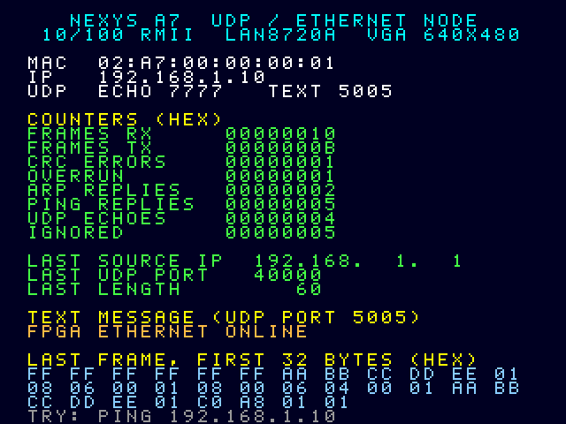
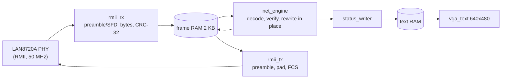

# UDP / Ethernet node with a VGA status display (Nexys A7)

A hardware network stack in Verilog for the Digilent **Nexys A7** (10/100 Ethernet PHY, LAN8720A, RMII).
The FPGA answers **ARP**, **ICMP ping**, and **UDP echo**, and shows live statistics, the last received
frame and any text you send it on a **VGA** dashboard. No CPU and no soft core: everything is state machines.


*Simulated VGA output after the testbench traffic.*

## Demo video

[](https://www.youtube.com/watch?v=SrmkjPqJhWU)

*ARP, ping, UDP text and UDP echo running on the Nexys A7.*

## What it does
| Feature | Details |
|---|---|
| Ping | `ping 192.168.1.10` is answered by the FPGA (ICMP echo reply) |
| UDP echo | UDP port **7777** returns the payload unchanged (up to ~1400 bytes) |
| Text on screen | UDP port **5005**: the first 32 bytes of the payload appear on the VGA screen (and are echoed) |
| ARP | Replies to "who has 192.168.1.10" |
| Checks | Ethernet CRC-32, IPv4 header checksum, destination MAC/IP, ports |
| Dashboard | Counters (RX, TX, CRC errors, overruns, ARP/ping/UDP, ignored), last source IP/port/length, text message, hex dump of the last frame |

## Architecture

**Design idea:** the received frame stays in RAM and the engine turns the *request into the reply in place*.
Swapping the two MACs, IPs and UDP ports does not change the ones-complement checksums, and the ICMP type
change (8 to 0) needs only `checksum += 0x0800`, so no checksum is recomputed from scratch and the payload is
never copied. The transmitter streams the reply from the same RAM.

Clocks: the 100 MHz board clock is divided to 50 MHz (RMII reference clock sent to the PHY through an ODDR,
and the stack clock) and 25 MHz (VGA). The VGA text RAM is a dual-clock block RAM, so the 50/25 MHz crossing
needs no synchronisers.

## Verification
`make test` (needs Icarus Verilog and Python 3). The testbench plays frames built by
`scripts/make_vectors.py` into the RMII receiver like a PHY would, captures what the design transmits, and
compares every reply byte for byte (FCS included) with a reply built independently in Python with all checksums
recomputed from scratch.

16 frames: ARP (for us / for another IP), pings with even/odd/57/1400-byte payloads, UDP echo (short padded,
1000-byte), UDP text, closed port, bad CRC, wrong MAC, bad IP checksum, TCP, a different TTL and source
address, and a frame whose last bytes arrive with the RMII `CRS_DV` toggling pattern. It also checks the
counters, the captured text message, and that a frame arriving while the buffer is busy is dropped and counted.

The testbench catches deliberately injected bugs: ICMP checksum off by one, ports not swapped, IP checksum check
removed, zero-padding removed, `CRS_DV` toggling unsupported, FCS byte order wrong, ARP target check removed.

## Using it on the board
1. Vivado: `cd` into this folder, `source create_project.tcl` (edit `part` for the 50T), then Synthesis,
   Implementation, Generate Bitstream, Program Device.
2. Connect a monitor (VGA) and an Ethernet cable from the laptop to the board.
3. Give the laptop's Ethernet adapter a fixed address: `192.168.1.1`, mask `255.255.255.0`, no gateway.
4. `python scripts/demo.py` runs everything in order, or by hand: `ping 192.168.1.10`, then `python3 scripts/udp_send.py text "HELLO FROM PYTHON"` and
   `python3 scripts/udp_send.py echo 50` (prints round-trip times).
5. LEDs show the low bytes of the received (LED0-7) and transmitted (LED8-15) frame counters.
Change the MAC/IP/ports with the parameters of `eth_node` and the labels in `scripts/gen_display.py`
(then `make display`).

## Status and limitations (please read)
- **Tested on hardware** (Nexys A7, laptop with Realtek GbE adapter at 100 Mb/s full duplex, direct cable): ARP, ping and UDP echo work.
  The RMII input/output delay values in the XDC are approximate; check them against the LAN8720A datasheet if you change the clocking.
- **TX timing note:** `TXD`/`TXEN` are launched on the *falling* edge of the 50 MHz clock (`rmii_tx.v`). Launching them on the same
  rising edge as the `REF_CLK` sent to the PHY leaves ~0 ns hold time at the PHY, and frames are then dropped by the receiving NIC
  (bad FCS) even though the design looks fine in simulation.
- One frame buffer: a frame that arrives while the previous one is still being processed or answered is
  dropped (counted as OVERRUN). A ping-pong buffer would remove this.
- 100 Mb/s link, store-and-forward, no IP fragmentation, no IP options, UDP checksum is not verified,
  no DHCP/gateway/routing (same subnet only), no MDIO/PHY configuration.
- The `ETH_REFCLK` clock is generated by the FPGA (the board's PHY is in "REF_CLK in" mode).

## Results (measured on the board)
| Test | Result |
|---|---|
| ARP | PC ARP table shows `02-a7-00-00-00-01` for 192.168.1.10 |
| Ping (`ping 192.168.1.10`) | 4/4 replies, 0 % loss, `time<1ms` |
| UDP text (port 5005) | message echoed back and shown on the VGA dashboard |
| UDP echo (`demo.py`, 50 x 64 bytes) | 50/50 replies, 0 mismatches, RTT min/avg/max = 0.18 / 0.27 / 0.43 ms |

Run the whole demo with one command: `python scripts/demo.py` (ARP, ping, UDP text, UDP echo with timings).
Resource usage and timing slack: see the Vivado utilization and timing reports of your own run.

## Repository layout
```
rtl/            rmii_rx, rmii_tx, frame_ram, net_engine, eth_udp (stack), vga_text, status_writer*,
                font_rom*, eth_node, top      (* generated by scripts/gen_display.py)
tb/             tb_eth.v + vectors/vectors.txt (generated)
scripts/        make_vectors.py, gen_display.py, frame2png.py, udp_send.py, demo.py
constraints/    nexys_a7_eth.xdc
```
## License
MIT, see `LICENSE`.
